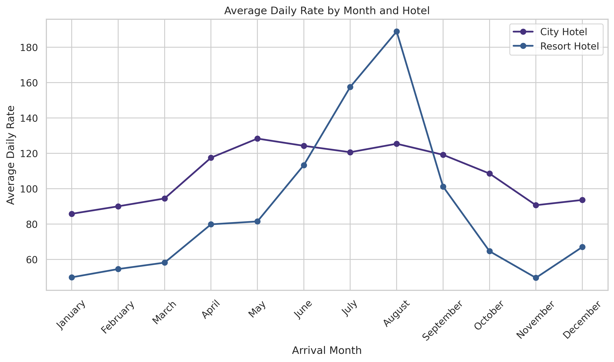
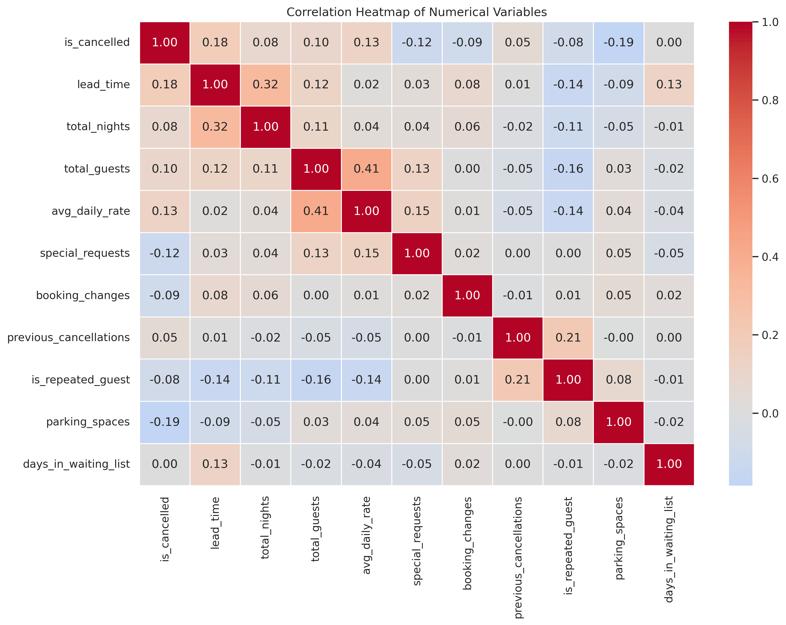
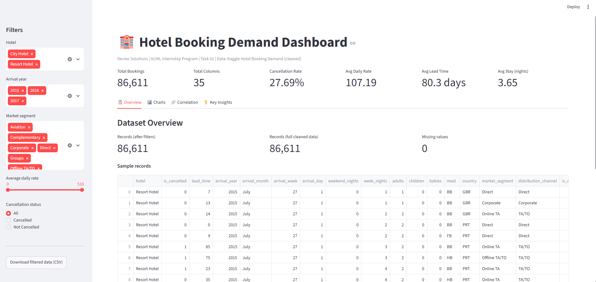
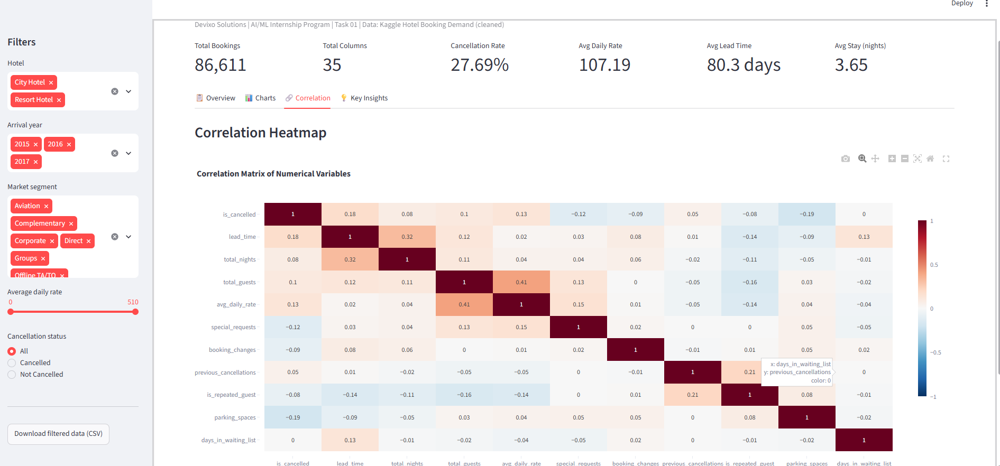

# Hotel Booking Demand Analysis

**Devixo Solutions | AI/ML Internship Program | Task 01: Python Programming, Data Analysis & Visualization**

**Author:** Aman Khan
**Internship Domain:** AI/ML

## Project Objective

To perform a complete data analysis workflow on a real-world hotel booking dataset: loading and understanding the data, cleaning and preprocessing it, exploratory and statistical analysis, data visualization, insight generation, and an interactive Streamlit dashboard.

## Dataset Description

The dataset contains booking records of two hotels in Portugal (a City Hotel and a Resort Hotel) with arrival dates from July 2015 to August 2017. Each row is one booking and includes lead time, length of stay, guests, meal plan, market segment, price per night (ADR), and whether the booking was cancelled.

- **Raw size:** 119,390 rows x 32 columns
- **Cleaned size:** 86,611 rows x 35 columns

## Dataset Source

Kaggle: [Hotel Booking Demand](https://www.kaggle.com/datasets/jessemostipak/hotel-booking-demand) by Jesse Mostipak.

## Technologies Used

Python 3, Google Colab, Jupyter Notebook, Streamlit, GitHub

## Libraries Used

Pandas, NumPy, Matplotlib, Seaborn, Plotly, Streamlit

## Project Workflow

Dataset Selection → Data Loading → Data Understanding → Data Cleaning → Exploratory Data Analysis → Statistical Analysis → Data Visualization → Insights → Conclusion → Documentation → GitHub

**Data cleaning summary:**

- Dropped `company` (94.3% missing); filled `agent`, `country`, `children`
- Removed 32,020 duplicate records
- Corrected data types and created `arrival_date`, `cancellation_status`, `total_guests`, `total_nights`
- Renamed 12 columns for clarity
- Removed 759 invalid rows (negative/extreme rate, zero guests, zero nights)

## Major Findings

- 27.69% of bookings are cancelled; the City Hotel (30.21%) cancels more than the Resort Hotel (23.72%).
- Online TA makes up 59.21% of bookings and has the highest cancellation rate (35.55%) among the main segments.
- Cancelled bookings were made earlier (105.8 days ahead) than completed ones (70.5 days).
- August is the busiest and most expensive month (11,194 bookings, average rate 151.70); January is the lowest.
- The strongest correlation is total guests vs average daily rate (0.41). All correlations with cancellation are weak (below 0.20).
- Median lead time (50 days) describes a typical booking better than the mean (80.31 days) because the data is right-skewed.

## Screenshots

| Monthly price trend                        | Correlation heatmap                     |
| ------------------------------------------ | --------------------------------------- |
|  |  |

| Dashboard overview                      | Dashboard correlation                   |
| --------------------------------------- | --------------------------------------- |
|  |  |

## Project Structure

```
Task_01_AI_ML/
├── dataset/        hotel_bookings.csv, cleaned_hotel_bookings.csv
├── notebook/       Task_01_Data_Analysis.ipynb
├── images/         visualization_01-13.png, dashboard screenshots
├── report/         Task_01_Report.pdf
├── app/            app.py (Streamlit dashboard)
├── requirements.txt
└── README.md
```

## How to Run the Project

1. Clone the repository and open the folder:
   ```
   git clone https://github.com/Amankhan987/Task_01_AI-ML_Hotel_Booking_Analysis.git
   cd Task_01_AI-ML_Hotel_Booking_Analysis
   ```
2. Install the libraries:
   ```
   pip install -r requirements.txt
   ```
3. **Notebook:** open `notebook/Task_01_Data_Analysis.ipynb` in Google Colab or Jupyter Notebook and run all cells. Update the dataset path at the top if needed.
4. **Dashboard:** run from the project root folder:
   ```
   streamlit run app/app.py
   ```
   Live dashboard: [your-streamlit-link]

## Author

**Aman Khan** | AI/ML Intern, Devixo Solutions
